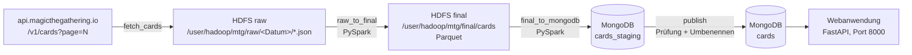

# ETL-Workflow

Prüfungsleistung Big Data, Thema „Create MTG Trading Card Database By API“.

## Überblick

Der gesamte Ablauf ist ein Airflow-DAG (`dags/mtg_cards.py`). Er läuft **täglich um 03:00 UTC** automatisch und kann in der Airflow-Oberfläche oder mit `make trigger` von Hand gestartet werden. Beim ersten Start der Umgebung läuft er sofort einmal, damit die Datenbank gefüllt wird.

| Komponente | Rolle |
|---|---|
| Airflow 2.10 (LocalExecutor, Metadaten in Postgres) | Steuerung, Zeitplan, Wiederholungen, Logs |
| HDFS 3.4 (NameNode und DataNode) | Raw-Layer und Final-Layer |
| PySpark 3.5 (lokaler Modus im Airflow-Container) | Bereinigung, Aufbereitung, Export |
| MongoDB 8.0 | Endnutzer-Datenbank |
| FastAPI | HTML-Frontend für die Suche |

## Datenquelle

`GET https://api.magicthegathering.io/v1/cards?page=N&pageSize=100` liefert die Karten seitenweise, höchstens 100 pro Seite. Die Header enthalten die Gesamtzahl (`Total-Count`, Stand November 2026: 93.643 Karten), die letzte Seite (`Link: …; rel="last"`, 937 Seiten) und das Rate-Limit (`Ratelimit-Limit: 1000`, `Ratelimit-Remaining`).

Eine Karte ist eine **Druckversion**: Dieselbe Karte erscheint in mehreren Editionen und hat dann je Edition eine eigene `id` und meist eine eigene `multiverseid`. Übersetzungen stehen im Feld `foreignNames` (Name, Text, Typ, Flavor-Text und Bild je Sprache).

## Tasks des DAGs `mtg_cards`

| # | Task | Operator | Zweck |
|---|---|---|---|
| 1 | `create_hdfs_dirs` | PythonOperator | Legt das Tagesverzeichnis im Raw-Layer und den Final-Ordner in HDFS an |
| 2 | `fetch_cards` | PythonOperator | Ruft alle Seiten der API ab und speichert jede unverändert als JSON in HDFS |
| 3 | `raw_to_final` | BashOperator → `spark-submit` | Bereinigt die Rohdaten und schreibt sie als Parquet in den Final-Layer |
| 4 | `final_to_mongodb` | BashOperator → `spark-submit` | Reichert die Daten für die Suche an und lädt sie in `cards_staging` |
| 5 | `publish` | PythonOperator | Prüft `cards_staging` und ersetzt damit die Collection `cards` |
| 6 | `cleanup_raw` | PythonOperator | Löscht Rohdaten älterer Läufe, die letzten 3 Tage bleiben |

Parameter `max_pages`: Begrenzt den Abruf auf die ersten N Seiten (`make trigger-test` = 5 Seiten, 500 Karten). Ohne Parameter werden alle Karten geladen.

### 1. `create_hdfs_dirs`

Legt `/user/hadoop/mtg/raw/<Datum>` und `/user/hadoop/mtg/final` an (WebHDFS `MKDIRS`). `<Datum>` ist das logische Datum des Laufs (`{{ ds }}`), so liegen die Rohdaten jedes Tages getrennt.

### 2. `fetch_cards` – API → Raw-Layer

Code: `etl/fetch.py`, HDFS-Zugriff: `etl/hdfs.py` (WebHDFS).

- Seite 1 abrufen, aus den Headern Gesamtzahl und letzte Seite bestimmen, dann Seite für Seite weiter.
- Jede Seite wird **unverändert** als `cards_page_0001.json` … `cards_page_0937.json` gespeichert. Der Raw-Layer ist damit eine originalgetreue Kopie der Quelle.
- Vor dem Speichern wird geprüft, dass die Antwort gültiges JSON mit einer Liste `cards` ist.
- Schreiben ist atomar: erst unter `…._tmp`, dann Umbenennen.
- Zusätzlich `_manifest.json` mit Zeitpunkt, Gesamtzahl laut API und Anzahl abgerufener Seiten.

Regeln für einen stabilen Abruf:

| Situation | Verhalten |
|---|---|
| HTTP 429 (Rate-Limit) oder 5xx, Netzwerkfehler | bis zu 8 Versuche mit wachsender Pause (10 s … 5 min), `Retry-After` wird beachtet |
| andere Fehler (z. B. 404) | sofortiger Abbruch |
| Task bricht trotzdem ab | Airflow wiederholt ihn bis zu 6-mal im Abstand von 10 min; Seiten, die schon in HDFS liegen, werden übersprungen |
| zwischen zwei Anfragen | 0,5 s Pause, um die API nicht zu überlasten |

### 3. `raw_to_final` – Raw-Layer → Final-Layer

Code: `jobs/raw_to_final.py`, Zieltabelle: `ddl/final_cards.sql`.

Spark liest alle Seiten eines Tages mit einem festen Schema. Felder, die die Suche nicht braucht (z. B. `legalities`, `rulings`, `variations`, fremde Sprachen außer Deutsch), werden dabei nicht übernommen. Danach wird jede Seite in einzelne Karten aufgelöst (`explode`).

Bereinigungsregeln:

| Regel | Begründung |
|---|---|
| Karten ohne `id` oder `name` werden verworfen | ohne ID nicht eindeutig, ohne Namen nicht suchbar |
| Duplikate nach `id` werden entfernt | die API-ID identifiziert eine Druckversion; gleichnamige Karten aus anderen Editionen bleiben bewusst erhalten |
| Texte: Leerraum am Rand entfernt, `\r\n` → `\n`, leere Texte → NULL | einheitliche Werte, keine leeren Strings in der Datenbank |
| `multiverseid` als Zahl (`BIGINT`) statt String | die API liefert sie als String |
| Edition (`set_code`) in Großbuchstaben | einheitliche Schreibweise |
| Bild-URLs `http://` → `https://` | sonst blockiert der Browser die Bilder auf einer https-Seite |
| deutsche Übersetzung aus `foreignNames` als eigene Spalten (`name_de`, `text_de`, `type_de`, `flavor_de`, `image_url_de`, `multiverseid_de`) | Suche auch nach deutschen Kartennamen, z. B. findet „Manta“ auch „Wolkenmanta“ |
| Feldnamen in snake_case (`manaCost` → `mana_cost`, `set` → `set_code`, `type` → `type_line`) | eindeutige Namen ohne reservierte Wörter |

Das Ergebnis wird mit den Spalten und Typen aus `ddl/final_cards.sql` als Parquet nach `/user/hadoop/mtg/final/cards` geschrieben (überschreibt den vorherigen Stand). Parquet ist spaltenorientiert und komprimiert. Beim ersten vollständigen Lauf schrumpften die Daten von 366 MB JSON (937 Seiten) auf 23 MB Parquet (4 Dateien). Der Job gibt aus, wie viele Karten gelesen, verworfen und als Duplikat entfernt wurden.

### 4. `final_to_mongodb` – Final-Layer → MongoDB (Staging)

Code: `jobs/final_to_mongodb.py`, Zielstruktur: `ddl/cards.json`.

Anreicherung für die Suche:

| Feld | Inhalt |
|---|---|
| `search.name`, `search.text`, `search.artist` | normalisierte Suchfelder: klein geschrieben, ohne Akzente, ß → ss, Æ → ae (`etl/text.py`). Name und Text enthalten Englisch und Deutsch |
| `color_names` | Farben auf Deutsch (W → Weiß, U → Blau …) |
| `versions` | Anzahl Druckversionen mit gleichem Namen (Spark-Window über `name`) |
| `mana_symbols` | Manakosten als Liste (`{2}{U}` → `["2", "U"]`) für die Anzeige |

Die Collection `cards_staging` wird vorher gelöscht und mit dem Validator aus `ddl/cards.json` neu angelegt. Jede Spark-Partition schreibt in Blöcken von 1.000 Dokumenten. Die API-ID wird `_id`, leere Felder werden weggelassen. Am Ende wird geprüft, dass `cards_staging` genau so viele Dokumente enthält wie der Final-Layer Zeilen. Sonst schlägt der Task fehl.

### 5. `publish` – Staging → produktive Collection

Code: `etl/mongo.py`.

- `cards_staging` darf nicht leer sein.
- Bei einem vollständigen Lauf darf der neue Stand höchstens 10 % kleiner sein als der bisherige. Das schützt davor, dass eine unvollständige Antwort der API die Suche leert.
- Indizes aus `ddl/cards.json` anlegen, dann `renameCollection` mit `dropTarget`. Der Tausch ist ein einzelner Schritt: Die Suche sieht immer entweder den alten oder den neuen Stand, nie eine halb geladene Collection.
- Datenstand (Anzahl, Zeitpunkt, Airflow-Lauf) in die Collection `meta` schreiben. Das Frontend zeigt ihn in der Fußzeile.

### 6. `cleanup_raw`

Behält die Rohdaten der letzten 3 Tage und löscht ältere Tagesverzeichnisse, damit HDFS bei täglichem Lauf nicht vollläuft.

### Ergebnis des ersten vollständigen Laufs (12.11.2026)

| Task | Dauer | Ergebnis |
|---|---|---|
| `fetch_cards` | 26 min | 937 Seiten, 93.643 Karten |
| `raw_to_final` | 13 s | 93.643 Karten, 0 ohne ID/Name, 0 Duplikate |
| `final_to_mongodb` | 9 s | 93.643 Dokumente in `cards_staging` |
| `publish` | 1 s | `cards` mit 93.643 Dokumenten veröffentlicht |

Die Dauer bestimmt fast ausschließlich der API-Abruf (ca. 1,7 s je Seite inklusive Pause). Die API liefert in diesem Stand keine doppelten IDs. Die Regel zur Deduplizierung bleibt trotzdem, weil sich Seiten verschieben können, wenn sich der Bestand während des Abrufs ändert.

## Datenmodell

| Schicht | Ort | Format | Inhalt |
|---|---|---|---|
| Raw | `/user/hadoop/mtg/raw/<Datum>/cards_page_NNNN.json` | JSON, wie von der API | alle Felder, alle Sprachen, eine Datei je Seite |
| Final | `/user/hadoop/mtg/final/cards/` | Parquet | bereinigte Karten, eine Zeile je Druckversion, 30 Spalten (`ddl/final_cards.sql`) |
| Frontend | MongoDB, Datenbank `mtg`, Collection `cards` | BSON-Dokumente | Final-Daten plus Suchfelder und Anreicherung (`ddl/cards.json`) |

### DDLs

Eine Datei je Tabelle, Dateiname = Tabellenname:

| Datei | Tabelle | Hinweis |
|---|---|---|
| `ddl/final_cards.sql` | `final_cards` (Spark SQL, Parquet in HDFS) | wird von beiden Spark-Jobs registriert; `raw_to_final.py` schreibt genau diese Spalten und Typen |
| `ddl/cards.json` | `cards` (MongoDB) | MongoDB hat kein `CREATE TABLE`; die Datei enthält das Äquivalent: JSON-Schema-Validator mit Pflichtfeldern und Typen sowie die Indizes. `cards_staging` wird mit derselben Definition angelegt |
| `ddl/meta.json` | `meta` (MongoDB) | Datenstand je veröffentlichter Collection |

## Webanwendung

Code: `web/app.py`, Abfragen: `web/search.py`.

- Suche nach **Name** (englisch und deutsch), **Kartentext** (englisch und deutsch), **Künstler** oder in allen drei Feldern.
- Teilstring-Suche ohne Beachtung von Groß-/Kleinschreibung und Akzenten. Die Eingabe wird mit derselben Funktion normalisiert wie die Suchfelder.
- Option „Jede Karte nur einmal“: Fasst Druckversionen gleichen Namens zusammen (MongoDB-Aggregation mit `$group`) und zeigt deren Anzahl.
- Ergebnisliste mit Bild, Name, deutschem Namen, Typ, Edition, Künstler und Multiverse-ID, 25 Treffer je Seite.
- Detailseite je Druckversion mit allen Feldern, deutschem Text, beiden Kartenbildern und Links zu den anderen Druckversionen.

Sicherheit:
- Die Webanwendung verbindet sich mit einem eigenen MongoDB-Benutzer, der nur Leserechte hat (`mtg_web`). Die ETL-Strecke schreibt mit `mtg_etl`.
- Suchbegriffe werden für den regulären Ausdruck maskiert, die Länge ist auf 100 Zeichen begrenzt.
- Ausgaben werden von Jinja automatisch escaped, dazu kommt eine Content Security Policy ohne Inline-Skripte.
